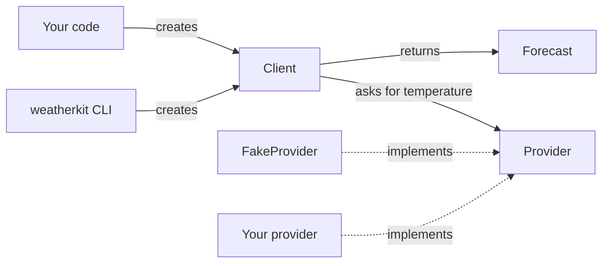

# Architecture

This page explains how weatherkit's parts fit together and why the data source is pluggable. Read it
if you want to understand the design before you extend it.

## Overview

*Notice that everything goes through `Client`, and that `Client` only knows the abstract `Provider`,
not any concrete data source.*

## How it works

weatherkit has three public pieces:

- **`Client`** is the entry point. It holds one provider and exposes `forecast(city)`.
- **`Provider`** is an abstract base class with one method, `temperature(city)`, which returns
  degrees Celsius. `FakeProvider` is the only implementation that ships with weatherkit.
- **`Forecast`** is a plain dataclass with `city` and `temp_c`, the value you get back.

When you call `forecast(city)`, the client calls `provider.temperature(city)` and wraps the number in a
`Forecast`. The CLI is a thin layer on top: it parses one `city` argument, calls
`Client().forecast(city)`, and prints the result.

## Design decisions and trade-offs

**Providers are pluggable.** Fetching data and presenting it are separate concerns. Keeping the data
source behind a one-method interface means you can connect any backend, or a stub in tests, without
changing the client or the `Forecast` model. The cost is that weatherkit doesn't ship a real-world
provider, so you write one yourself.

**The default provider is a fake.** `Client()` with no arguments uses `FakeProvider`, which always
returns 21.5 °C. That makes the library work offline and deterministically from the first line,
which suits demos and tests. The trade-off is surprise: a newcomer who expects live data gets the
same number for every city.

**The CLI doesn't take a provider.** It always uses the default, which keeps it to a single argument.
To use another data source, call weatherkit from Python.

**A cache exists but isn't used yet.** Each `Client` creates a private cache object, but `forecast`
doesn't read from or write to it, so every call reaches the provider. It's internal, so it isn't part
of the public API.

## Related

- [How to use a custom provider](../how-to/custom-provider.md)
- [Generated diagrams](../reference/diagrams.md): the actual import graph and class hierarchy
- [API reference](../reference/api/weatherkit/index.md)
