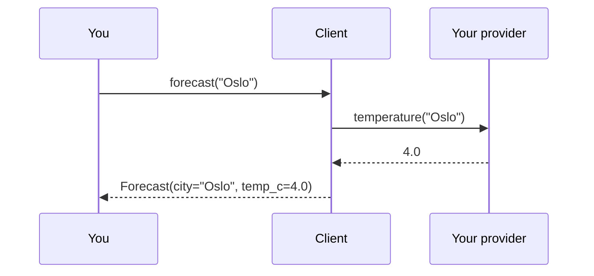

# How to use a custom provider

Use this guide when you want weatherkit to return temperatures from your own data source (an API, a
database, a file) instead of the built-in `FakeProvider`.

**Prerequisites:** completed [Getting started](../tutorials/getting-started.md).

## How a provider is called

When you call `Client.forecast(city)`, the client asks its provider for the temperature and wraps the
result in a `Forecast`:


*Your provider only has to return a number of degrees Celsius; the client builds the `Forecast`.*

## Step 1: Subclass `Provider`

Subclass `weatherkit.providers.base.Provider` and implement `temperature(city)` so it returns the
temperature in degrees Celsius as a `float`. This example reads from a dictionary; in your code, call
your real data source here.

```python
from weatherkit.providers.base import Provider


class TableProvider(Provider):
    """Looks up temperatures in a dictionary."""

    def __init__(self, temperatures: dict[str, float]):
        self.temperatures = temperatures

    def temperature(self, city: str) -> float:
        return self.temperatures[city]
```

`Provider` is an abstract base class, so a subclass that doesn't implement `temperature` raises
`TypeError` when you instantiate it.

## Step 2: Pass the provider to `Client`

```python
from weatherkit import Client

client = Client(provider=TableProvider({"Oslo": 4.0, "Lima": 19.0}))
print(client.forecast("Oslo"))
```

## Verify

The example above prints the temperature from your provider rather than the fake 21.5 °C:

```text
Forecast(city='Oslo', temp_c=4.0)
```

## Troubleshooting

??? question "`TypeError: Can't instantiate abstract class ... temperature`"
    Your subclass doesn't define `temperature`, or the method name is misspelled. Implement
    `temperature(self, city: str) -> float`.

??? question "An exception from my data source reaches the caller"
    `Client.forecast` doesn't catch exceptions from the provider. Handle errors such as unknown
    cities or network failures inside `temperature`, or around your call to `forecast`.

??? question "The `weatherkit` command still returns 21.5 °C"
    The CLI always uses the default `FakeProvider`; it has no option to choose a provider. Use your
    provider from Python.

## Related

- [`Provider` API reference](../reference/api/weatherkit/providers/base.md)
- [`Client` API reference](../reference/api/weatherkit/client.md)
- [How to test with providers](test-with-providers.md)
- [Architecture](../explanation/architecture.md): why providers are pluggable
